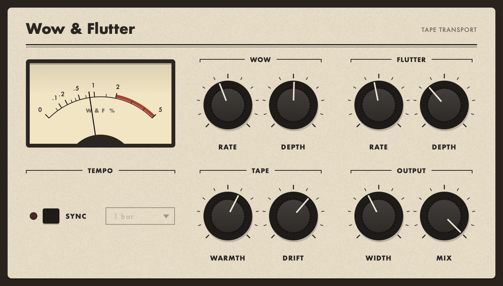

# Wow & Flutter

**A stereo tape-transport simulator for macOS (Audio Unit), built with JUCE.**


Wow & Flutter recreates the pitch wobble of tape machines: slow *wow* from a warped reel
or a tired capstan, fast *flutter* from the transport, and the uneven way real
machines drift. A **Warmth** stage adds tape colour: saturation, a head bump and
high-frequency loss. Use it subtly to give digital sources some life, or turn it up for
seasick, warped-record effects.

The UI looks like an old piece of studio hardware: an enamel faceplate, black skirted knobs
with printed 0–10 scales, and a needle meter that shows the live speed deviation (in %) the
plugin is applying. Hover over or drag any knob and its label changes to the current value.

---

## What it does

- **Wow**: slow pitch drift, 0.1–2 Hz, up to 5 ms deep. It can sync to the host tempo
  (4 bars to 1/16).
- **Flutter**: fast wobble, 2–14 Hz, with a 12 Hz shimmer layered on top.
- **Drift**: blends in smooth random movement. Wow speed wanders, flutter swells and
  fades, and a fast "scrape" component appears, so it never sounds like a plain LFO.
- **Warmth**: asymmetric tape saturation (unity gain at low levels), an 18 Hz subsonic cut, a
  90 Hz head bump (up to +4.5 dB) and playback high-frequency loss (20 kHz → 8 kHz).
- **Width**: phase-offsets the right channel by up to 60° and gives it its own random sources
  for a wide, chorus-like spread.
- **Mix**: dry and wet are read from the same delay line, so they stay time-aligned and
  blending them doesn't cause comb filtering.
- **10 factory presets**: Fresh Cassette, Worn Cassette, Walkman, Reel to Reel, VHS Drift,
  Warped Record, Dictaphone, Seasick, Tape Chorus, Colour Only.

| Worn Cassette | Seasick |
|---|---|
|  |  |

## Parameters

| Control | Range | Default |
|---------|-------|---------|
| Wow Rate | 0.1–2.0 Hz | 0.5 Hz |
| Wow Depth | 0–5 ms | 0.8 ms |
| Flutter Rate | 2–14 Hz | 6 Hz |
| Flutter Depth | 0–5 ms | 0.1 ms |
| Warmth | 0–100% | 50% |
| Drift | 0–100% | 50% |
| Stereo Width | 0–100% | 40% |
| Mix | 0–100% | 100% |
| Sync to BPM | on / off | off |
| Wow Division | 4 bars, 2 bars, 1 bar, 1/2, 1/4, 1/8, 1/16 | 1 bar |

## How it works

- **Modulated delay line**: each channel writes into a circular buffer and reads it back
  through a moving read head centred at 16 ms. The moving read time is what changes the
  pitch. Reads use Catmull-Rom cubic interpolation, so the modulation sounds smooth.
  The plugin reports the 16 ms centre to the host as latency.
- **Slope-continuous randomness**: the Drift sources glide between random points with a
  smoothstep curve. That keeps both the curve and its slope continuous, so the pitch (the
  slope of the delay time) never jumps.
- **Tape colour** uses RBJ biquads (subsonic high-pass, head-bump peak, HF-loss low-pass)
  after a `tanh` saturator.
- Depth, width, mix and warmth are smoothed over 50 ms, so moving a knob never clicks.
  The audio thread never allocates memory.

## Building

Requirements: macOS, Xcode command-line tools, CMake 3.21+.

```bash
git clone --recursive https://github.com/kolotammaman/WowFlutter.git
cd WowFlutter
cmake -B build -G Xcode
cmake --build build --config Release
```

JUCE 8.0.12 is included as a git submodule. If you cloned without `--recursive`, run
`git submodule update --init` first. The built `WowFlutter.component` is copied to
`~/Library/Audio/Plug-Ins/Components/`. Rescan AU plugins in your DAW to pick it up.

## License

[AGPL-3.0](LICENSE). Built on [JUCE](https://juce.com), which is used under its AGPLv3 license.

---

*Designed and built by molo in collaboration with Claude.*
